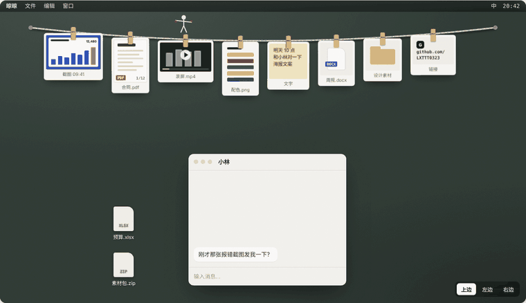

<p align="center">
  
</p>

<h1 align="center">晾晾 Pegline</h1>

<p align="center"><b>截图，先晾着。</b><br>屏幕顶上的一根绳子。截图、复制的文件和文字自己挂上去，要用时伸手就拿。</p>

<p align="center">
  <a href="https://github.com/LXTTT0323/pegline/releases/latest"></a>
  <a href="https://github.com/LXTTT0323/pegline/releases"></a>
  
  <a href="LICENSE"></a>
</p>

<p align="center">
  <a href="https://lxttt0323.github.io/pegline/"><b>官网</b></a> ·
  <a href="https://github.com/LXTTT0323/pegline/releases/latest"><b>下载</b></a> ·
  <a href="https://lxttt0323.github.io/pegline/privacy.html">隐私</a> ·
  <a href="#english">English</a>
</p>

<p align="center">
  
</p>

## 它能做什么

- **什么都能挂。** 截图、图片、PDF、视频、文档、文件夹、文字、链接。PDF 挂着也能翻页。
- **自己挂上去。** 截个图、复制个文件或一段字，它就出现在绳上。也可以只收截图，或者只靠拖拽。
- **按住，拖走。** 拖出去的是一份真正的文件，聊天、邮件、文档、网页上传框、文件夹都能放。原件还挂在绳上。
- **想挂哪就挂哪。** 沿着绳子拖到最前、最后或任意位置；绳子能挂在屏幕上边、左边或右边。
- **钉在屏幕上。** 双击变成悬浮小窗，压在所有窗口上面，滚轮缩放，还能调透明度。
- **虚影模式。** 截了马上就用、不想留？它先半透明挂几秒，点一下才留下，不理它就自己消失。
- **七套皮肤。** 白昼、赛博机甲、软木板、夜航、蓝图、汽水糖、草莓甜心，绳上还有会动的小东西。
- **不联网。** 没有账号，没有统计，东西只存在你自己的电脑里。

## 下载

| 系统 | 文件 |
| --- | --- |
| Windows 10 / 11 | [`Pegline-Setup-1.5.0.exe`](https://github.com/LXTTT0323/pegline/releases/download/v1.5.0/Pegline-Setup-1.5.0.exe) |
| macOS 11+ · Apple 芯片 | [`Pegline-1.5.0-mac-arm64.zip`](https://github.com/LXTTT0323/pegline/releases/download/v1.5.0/Pegline-1.5.0-mac-arm64.zip) |
| macOS 11+ · Intel 芯片 | [`Pegline-1.5.0-mac-x64.zip`](https://github.com/LXTTT0323/pegline/releases/download/v1.5.0/Pegline-1.5.0-mac-x64.zip) |

安装包还没有代码签名：Windows 提示「已保护你的电脑」时点「更多信息 → 仍要运行」；Mac 第一次打开时右键 →「打开」。详见[安装帮助](https://lxttt0323.github.io/pegline/#help)。

## 快捷键

| | Windows | macOS |
| --- | --- | --- |
| 截个图，挂上绳 | `Ctrl` `Alt` `S` | `⌃` `⌥` `S` |
| 把剪贴板挂上去 | `Ctrl` `Alt` `V` | `⌃` `⌥` `V` |
| 放下 / 收起绳子 | `Ctrl` `Alt` `T` | `⌃` `⌥` `T` |

## 从源码运行

需要 Node.js 18 或更新版本。

```bash
git clone https://github.com/LXTTT0323/pegline.git
cd pegline
npm install
npm start            # 直接运行
npm run dist         # 打包 Windows 安装包，输出在 dist/
npm run dist:mac     # 打包 Mac 版（Apple 芯片 + Intel）
```

代码结构很小：`main.js` 是主进程（剪贴板、窗口、托盘），`rope.html` / `rope.js` 是绳子，`pin.html` / `pin.js` 是钉在屏幕上的小窗，`skins.css` 是七套皮肤。官网在 `docs/`，由 GitHub Pages 发布。

## 致谢

晾衣绳这个点子来自 Alejandro Buján 的开源 macOS 应用 [Tendedero](https://github.com/alejandrobujan/tendedero)（MIT）。晾晾是受它启发、从头写的 Windows 和 Mac 版本。PDF 预览用的是 Mozilla 的 [PDF.js](https://mozilla.github.io/pdf.js/)（Apache 2.0）。

## 许可

代码以 [MIT](LICENSE) 许可开源。「晾晾」「Pegline」这两个名字和图标不在许可范围内，发布分支版本请换上自己的名字和图标。

---

<a id="english"></a>

## English

**Pegline** puts a clothesline along the top of your screen. Screenshots, copied files and text hang themselves on it; click a card to copy it, drag it into any app or folder (the original stays on the line), pin it above every window, or let it vanish in ghost mode. Images, PDFs (with page turning), videos, documents, folders, text and links all hang. Seven skins, three edges (top, left, right), no network, no account. Windows 10/11 and macOS 11+.

Inspired by [Tendedero](https://github.com/alejandrobujan/tendedero) by Alejandro Buján. Code under the [MIT license](LICENSE); the Pegline name and icon are excluded.
